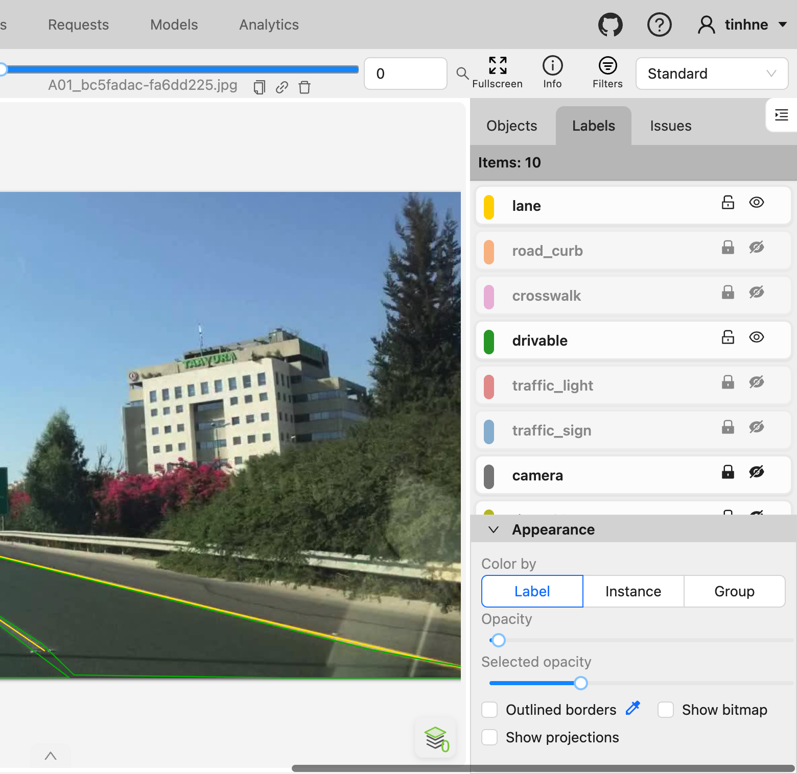
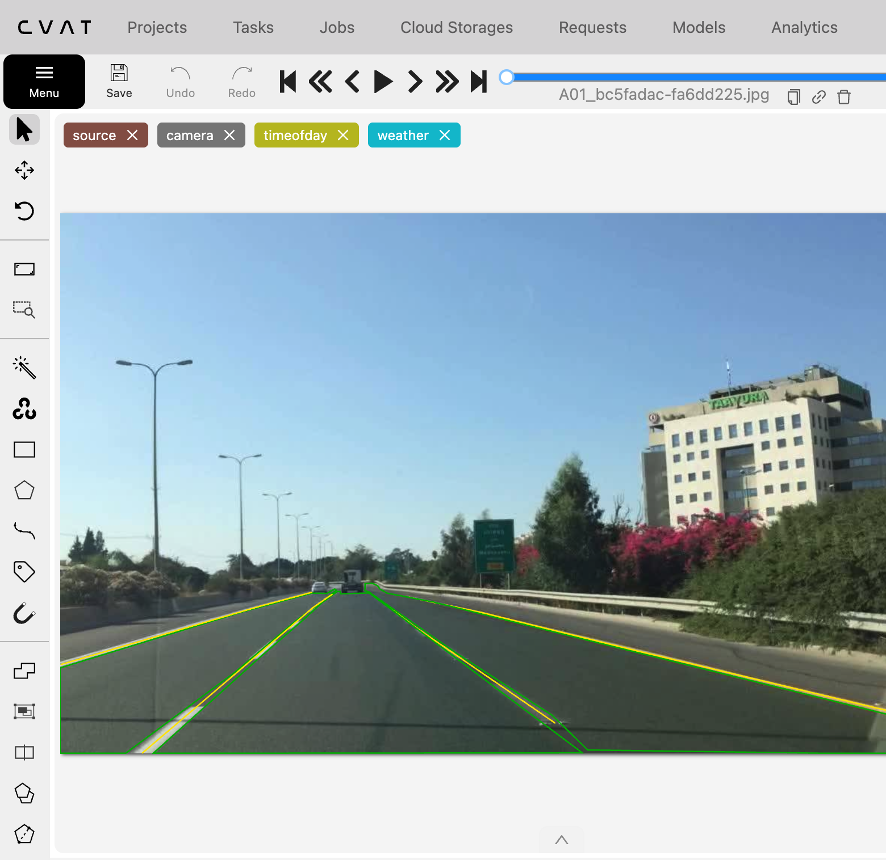
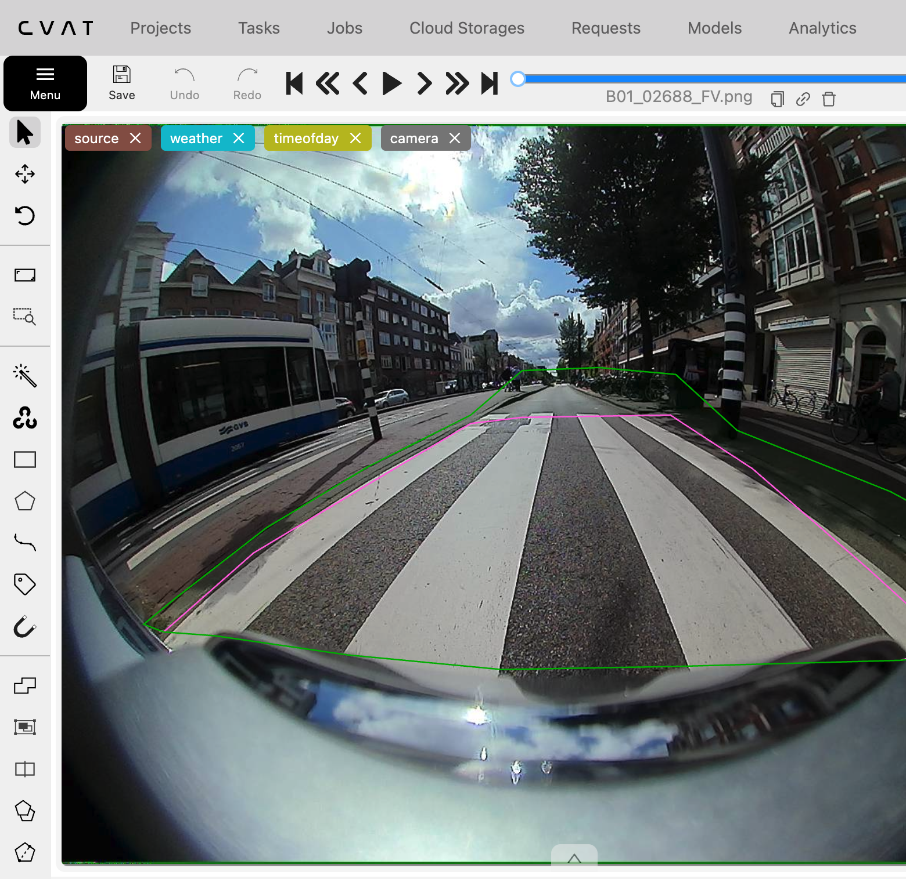

# Báo cáo cá nhân — Ngày 11
Họ tên: Lê Văn Trung Tính
Mã học viên: 2A202603145
Phiên bản CVAT (Help → About): 2.82.0
Guideline: Road v1.0
Lần nộp (`revision` trong manifest): 2
Thời điểm export (ngày giờ trên CVAT): 21/11/2026
Số lần nộp lại sau Rework: 1

## 1. Kiểm project
| Mục | Đúng như guideline Road v1.0? | Ghi chú |
| --- | --- | --- |
| 6 label, đúng kiểu | Có | lane và road_curb là polyline; crosswalk và drivable là polygon; traffic_light và traffic_sign là rectangle. |
| Thuộc tính và giá trị | Có | lane có position, style, color, kind; drivable có area_type; traffic_light có color, type, facing, edge_zone; traffic_sign có group, facing, edge_zone. |
| 4 tag ảnh | Có | Mỗi ảnh có camera, timeofday, weather và source. Manifest xác nhận 12/12 ảnh front và 8/8 ảnh fisheye đều có đủ bốn tag. |
Cách kết thúc polyline trên bản CVAT này: Điểm cuối đặt tại vị trí vạch không còn nhìn rõ hoặc sát mép khung quan sát; giữ chiều vẽ từ gần ra xa.
Cách đặt tag ảnh trên bản CVAT này: Mở Details của ảnh, đặt 4 tag rồi kiểm lại giá trị trước khi chuyển sang ảnh kế tiếp.

## 2. Số lượng đã gán
| Task | Ảnh | lane | road_curb | crosswalk | drivable | traffic_light | traffic_sign |
| --- | ---: | ---: | ---: | ---: | ---: | ---: | ---: |
| front | 12 | 33 | 3 | 6 | 26 | 20 | 22 |
| front-extra (đã làm 4 / 4) | Không tách ra trong báo cáo | Không tách ra trong báo cáo | Không tách ra trong báo cáo | Không tách ra trong báo cáo | Không tách ra trong báo cáo | Không tách ra trong báo cáo | Không tách ra trong báo cáo |
| fisheye | 8 | 12 | 4 | 7 | 9 | 3 | 0 |
| fisheye-extra (đã làm 4 / 4) | Không tách ra trong báo cáo | Không tách ra trong báo cáo | Không tách ra trong báo cáo | Không tách ra trong báo cáo | Không tách ra trong báo cáo | Không tách ra trong báo cáo | Không tách ra trong báo cáo |

## 3. Bảng ca khó
| Ảnh | Nhãn | Phân vân giữa | Đã chọn | Lý do |
| --- | --- | --- | --- | --- |
| A03 | lane | Hai lane và vạch đứt L1 | Đặt lane bên phải là R1; giữ L1 theo một lane riêng | Đã xử lý theo lỗi QC1-02/R1 và lỗi QC1-05 ở bản revision 2 |
| A05 | lane | Có thể thiếu L1 hoặc R1 | Chưa gán lane | Không suy đoán vị trí vạch ở đoạn ảnh không nhìn rõ |
| A06 | lane | Có thể thiếu L1 hoặc R1 | Chưa gán lane | Chỉ gán lane khi vạch có đủ căn cứ trực quan |
| A08 | lane | Hai đoạn cùng R1 hoặc L2 có phải một vạch đứt hay không | Giữ hai đoạn trong lúc chưa QC lại | Cần kiểm lại thuộc tính position và cách gộp các đoạn của cùng vạch |
| A09 | lane | R1 có nhìn thấy hay không | Chưa gán R1 | Kiểm lại ảnh trước khi kết luận thiếu vạch |
| A12 | lane | R1 có nhìn thấy hay không | Chưa gán R1 | Không thêm vạch nếu không có hình ảnh trực tiếp |

## 4. Phiếu QC 1 nhận được
Bạn kiểm lô của tôi: Đinh Quang Thắng
Phiếu chi tiết: [DinhQuangThang-qc1-for-LeVanTrungTinh.md](r1/DinhQuangThang-qc1-for-LeVanTrungTinh.md)
Quyết định nhận được: Rework
| Mã lỗi | Số lỗi | Đồng ý? | Đã sửa? |
| --- | ---: | --- | --- |
| QC1-02 thiếu L1/R1 | 8 | Đồng ý | Đã sửa |
| QC1-05 vạch đứt | 1 | Đồng ý | Đã sửa |

Cá nhân đã kiểm 12 ảnh và 109 nhãn theo phiếu. Lô có 8 lỗi nặng QC1-02 gồm A03, B01, B02, B03 và B04; có 1 lỗi chính QC1-05 tại A03. Lỗi chính chiếm 1/109 nhãn = 0,92%, dưới 5%, nhưng có lỗi nặng nên quyết định là Rework.

Bản revision 2 đã sửa:
- A03: tách sai hai lane đã được xử lý và lane bên phải được đặt `R1`.
- B01: đã bổ sung lane `L1` và `R1`.
- B02: đã bổ sung lane `L1` và `R1`.
- B03: đã bổ sung lane `L1`.
- B04: đã bổ sung lane `R1`.

## 5. Kiểm file export
| File | Mở lại được? | Số shape ảnh 1 (job / file) | Số shape ảnh 2 (job / file) | Tag camera có trong XML? |
| --- | --- | --- | --- | --- |
| `LeVanTrungTinh-front.zip` | Có | A01: 7 shape / 7 shape | A02: 8 shape / 8 shape | Có; 12/12 ảnh |
| `LeVanTrungTinh-fisheye.zip` | Có | B01: 6 shape / 6 shape | B02: 4 shape / 4 shape | Có; 8/8 ảnh |

## 6. Ảnh chụp màn hình
1. Tab Labels của project:
   
2. Một ảnh camera trước đã gán đủ (làn, vùng lái, đèn/biển):
   
3. Một ảnh fisheye đã gán, phóng to đoạn polyline cong:
   
4. Một đoạn XML có `<polyline label="lane">`:
```xml
<polyline label="lane" source="manual" occluded="0"
          points="659.43,679.90;473.20,551.79;419.51,511.70" z_order="0">
  <attribute name="position">R1</attribute>
  <attribute name="style">dashed</attribute>
  <attribute name="color">white</attribute>
  <attribute name="kind">single</attribute>
</polyline>
```

## 7. Tự đánh giá
Lỗi bạn mắc nhiều nhất hôm nay (theo mã QC1-xx), và cách tránh ở Ngày 20:
Lỗi nhiều nhất là QC1-02: thiếu L1/R1. Ở Ngày 20 sẽ kiểm đủ hai lane chủ đạo trên từng ảnh trước, đánh dấu từng vị trí `L1` và `R1`, rồi mới xem ảnh có thật sự không có vạch hay chỉ bị che/không nhìn rõ.

Còn một lỗi QC1-05 tại A03: vạch đứt L1 bị tách thành hai polyline. Cách tránh là mỗi vạch đứt được gán bằng một polyline duy nhất, điểm còn lại được nối qua chỗ che bằng cờ `occluded`.

Nhãn của bạn đi vào model ở đâu? Chọn một lỗi đã sửa và nói nó làm model học sai thế nào:
Nếu thiếu lane R1 hoặc L1, model mất một mẫu quan trọng để xác định hai mép làn chủ đạo và có thể dự đoán lệch hướng hoặc bỏ sót lane ở đầu ra. Với vạch đứt bị tách thành hai polyline, model có thể học hai đoạn rời thay vì một vạch liên tục, dẫn tới đường làn bị gián đoạn hoặc sai khoảng cách.

## 8. (Tùy chọn, buffer) Từ polyline đến đích row-anchor
| y | 720 | 680 | 640 | 600 | 560 |
| --- | ---: | ---: | ---: | ---: | ---: |
| x của chúng tôi | không có làn | không có làn | 601.4 | 543.3 | 485.1 |
| x của bạn kia | 710.7 | 654.4 | 598.1 | 541.8 | 485.8 |

Kết quả này được tính bằng `rowanchor` trên ảnh A01, vạch `R1`. Với bài của chúng tôi, polyline R1 hiện bắt đầu ở y ≈ 680 nên các hàng y=720 và y=680 không tạo được x.

Trả lời 3 câu:

1. Năm số x trên là đích row-anchor mà model có thể học cho vạch R1. Nếu polyline được dừng sớm 40 px theo hướng còn thiếu ở phía gần xe, hàng y=680 sẽ từ “không có làn” hoặc đã có x thành “không có làn”; đồng thời hàng y=720 vẫn không có làn.
2. Ở hàng y=720, hai bạn lệch nhau ở mức một bên không có làn còn bên kia có x≈710.7. Ở hàng y=560, khoảng cách chỉ khoảng 0.7 px (485.1 so với 485.8). Nhìn chung hàng y=720 hoặc y=680 ảnh hưởng LKA mạnh hơn vì nằm gần xe; đó là vùng model cần vị trí làn chính xác để điều chỉnh lái.
3. Nếu polyline được vẽ từ xa về gần, thứ tự điểm thay đổi nhưng công thức nội suy theo từng đoạn vẫn tìm được x khi biết hai điểm bao quanh hàng y. Script `rowanchor` không đảo kết quả x; các script lấy `points[0]`/điểm cuối làm đầu gần hoặc đầu xa, hoặc sắp xếp theo chiều cố định thì sẽ gặp khó. Đây là lý do quy tắc gán yêu cầu vẽ từ gần ra xa.
